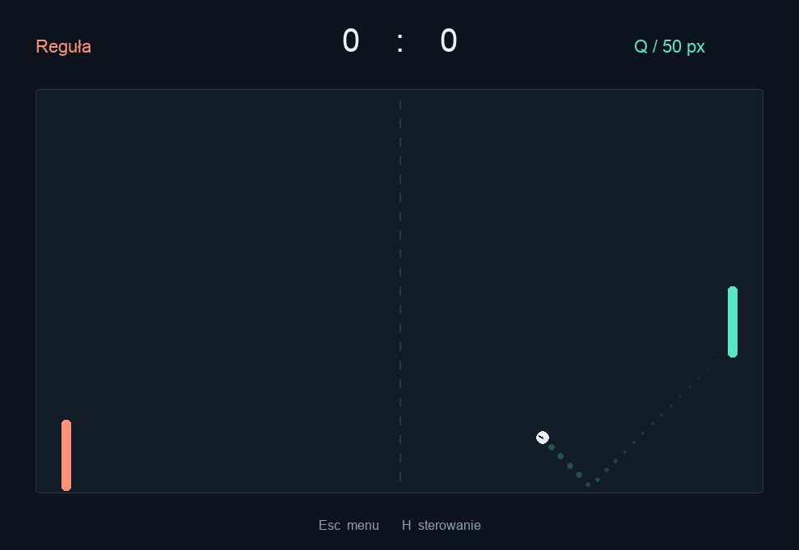
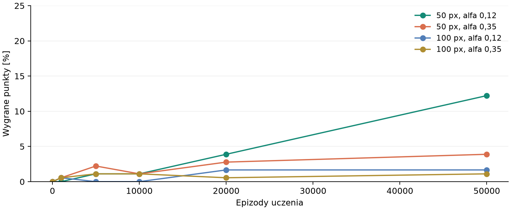
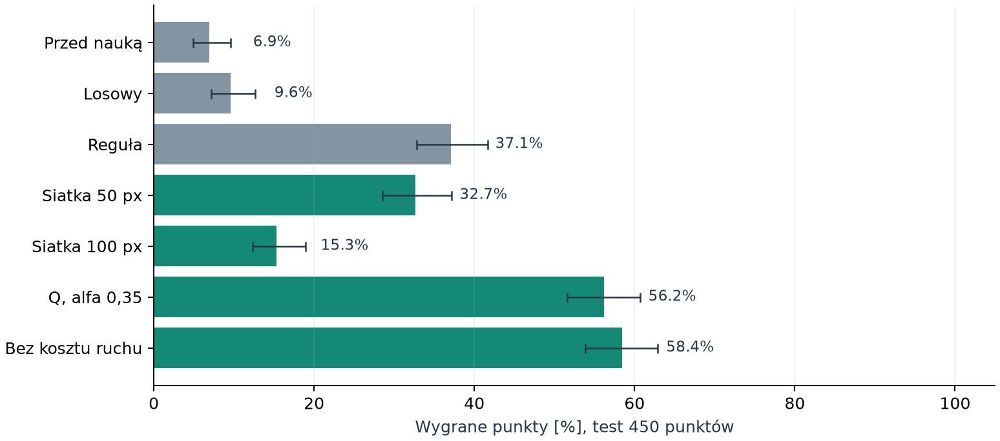

# PONG
Przeciwnik uczący się grać

Projekt 1 / Zespół 1 / poniedziałek 8:00-10:15
Sztuczna inteligencja w grach i rozszerzonej rzeczywistości
Sprawozdanie, 15 listopada 2026 r.

Agent uczy się sterować paletką w PONG-u metodą prób i błędów. Po 20 000 epizodów trzy wytrenowane modele wygrywają średnio 62,8% punktów w ocenie końcowej. Przed nauką agent wygrywa 6,9%. Przeciwnikiem w tym pomiarze jest reguła śledząca bieżącą wysokość piłki.



Rys. 1. Gra w trybie demonstracji. Wyuczony agent steruje prawą paletką.

| Osoba | Odpowiedzialność |
| --- | --- |
| Artur Zamorowski | Symulacja, model fizyki i kolizje. |
| Kacper Wojtowicz | Q-learning, reprezentacja stanu i eksperymenty. |
| Rafał Wybraniec | Interfejs i dokumentacja. |

---

# 1. Zadanie i architektura

Agent steruje prawą paletką. Wybiera ruch w górę, postój albo ruch w dół, zapisane jako akcje -1, 0 i +1. Obserwacja zawiera położenie i prędkość piłki, rotację oraz położenie i prędkość własnej paletki. Pozycja przeciwnika pozostaje poza obserwacją.

Za punkt uznajemy przejście piłki poza boczną granicę boiska. Epizod treningowy kończy się po punkcie albo po 20 s czasu symulowanego. Serwis losuje kierunek, kąt i wysokość piłki oraz początkowe położenia obu paletek.

## Podział programu

| Moduł | Rola i przepływ danych |
| --- | --- |
| config.py | Stałe boiska, fizyki i częstotliwości symulacji. |
| physics.py | Pong.reset(), observe(), step(). Akcje obu stron zmieniają stan i zwracają wynik przejścia. |
| agents.py | Dyskretyzacja obserwacji, tablica Q, aktualizacja, strategie odniesienia i zapis modelu. |
| experiments.py | Generowanie epizodów bez grafiki, ocena zamrożonych modeli, CSV i metadane. |
| gui.py | Sceny menu, gry, pauzy i końca meczu. Obsługa klawiatury i rysowanie stanu rdzenia. |
| app.py, settings.py | Odczyt konfiguracja.yaml, sprawdzenie parametrów i uruchomienie wybranego trybu. |
| narzedzia/ | Wykresy i generowanie dokumentów PDF. |

Trening i gra korzystają z tej samej symulacji. Podczas treningu agent wybiera akcję, wykonuje krok i poprawia jedną wartość w tablicy Q. W grze odczytuje gotową tablicę. Fizyka ma stały krok czasu, niezależny od rysowania.

Program uruchamia plik kod/main.py bez argumentów. Tryb, model i parametry wybiera konfiguracja.yaml. Ścieżki w ustawieniach odnoszą się do katalogu projektu.

## Środowisko wykonawcze

Pomiary wykonano w Pythonie 3.13.12 z NumPy 2.3.5. Interfejs korzysta z Pygame-ce 2.5.8 i SDL. NumPy przechowuje tablice, PyYAML 6.0.3 odczytuje ustawienia, Matplotlib tworzy wykresy, a ReportLab PDF-y. Dokładne wersje przypięto w plikach wymagań.

Pygame-ce obsługuje okno, klawiaturę i rysowanie. Pętlę gry oraz model fizyczny zawierają moduły projektu.

---

# 2. Fizyka rozgrywki

Paletka przyspiesza i hamuje, więc agent musi rozpocząć ruch przed nadejściem piłki. Miejsce trafienia i prędkość paletki zmieniają odbicie. Ruch paletki nadaje też rotację, która zakrzywia dalszy tor lotu.

| Parametr | Wartość w scenariuszu standard |
| --- | --- |
| Boisko / paletka / promień piłki | 900 x 500 px / 12 x 88 px / 8 px |
| Prędkość / przyspieszenie paletki | 460 px/s / 3600 px/s², identyczne po obu stronach |
| Szybkość piłki | 430 px/s na starcie, wzrost x1,06 po odbiciu, limit 800 px/s |
| Odbicie | Kąt zależny od miejsca trafienia, maks. 0,96 rad przed korektą ruchu |
| Krok fizyki / decyzji | 1/120 s / 1/30 s |
| Rotacja | Zakres [-7, 7], wykładniczy zanik z parametrem 0,55 s⁻¹ |

## Przebieg pojedynczego kroku

W każdym kroku symulator przesuwa paletki i ogranicza ich pozycje do boiska. Potem oblicza wpływ rotacji na prędkość piłki, przesuwa ją i rozpatruje kolizje. Jeśli piłka przekroczy powierzchnię odbicia, zachowuje pozostałą część drogi po przeciwnej stronie. Dzięki temu odbicie nie zatrzymuje jej na przeszkodzie.

```
u = clip((y_pilki - y_paletki) / 44, -1, 1)
speed = min(800, 1.06 * hypot(vx, vy))
vy_out = clip(speed*sin(0.96*u) + 0.22*vp,
              -0.88*speed, 0.88*speed)
abs(vx_out) = sqrt(speed**2 - vy_out**2)
```

Rotacja wynosi clip(5·v_p/460 + 2·u, -7, 7). W locie składnik pionowy zmienia się o 0,13·spin·v_x·dt. Potem normalizujemy wektor do poprzedniej szybkości. Tor zakrzywia się, lecz sam efekt rotacji nie dodaje energii. Odbicie od poziomej ściany zmienia znak i zmniejsza rotację współczynnikiem 0,8.

Sprawdzenie przecięcia czoła paletki wykrywa kontakt także wtedy, gdy piłka przeskoczy tę płaszczyznę w jednym kroku. Pionowy zasięg kontaktu obejmuje dodatkowo promień piłki, co upraszcza kolizje przy narożnikach. Parametry fizyki dobrano do gry zręcznościowej. Nie odwzorowują pomiarów rzeczywistej piłki.

Test simple_physics wyłącza zależność odbicia od miejsca trafienia, ruchu paletki i rotacji. Pozostawia odbicia od ścian oraz wzrost szybkości. Zmienia dynamikę gotowego modelu i służy do oceny jego przenoszenia.

---

# 3. Stan agenta i uczenie

Tablicowy Q-learning [1] przypisuje każdemu stanowi trzy wartości, po jednej dla każdej akcji. Wszystkie wartości zaczynają od zera. Agent poznaje skutki własnych ruchów podczas kolejnych epizodów.

```
Q[s,a] = Q[s,a] + alfa * (r + gamma*max(Q[s_next])
                         - Q[s,a])
Dla zdobytego/straconego punktu: max(Q[s_next]) = 0
```

Współczynnik alfa wynosi 0,12, a gamma 0,98. Epsilon maleje liniowo z 0,9 do 0,05 przez pierwsze 85% epizodów i pozostaje na tym poziomie. Podczas oceny epsilon wynosi zero. Przy równych wartościach agent wybiera postój. Po zdobyciu lub stracie punktu aktualizacja pomija wartość następnego stanu. Przy samym limicie czasu nadal ją uwzględnia.

| Reprezentacja | Opis | Liczba stanów |
| --- | --- | --- |
| Siatka 50 px | 18 kolumn, 19 różnic wierszy, znak vx, 3 kategorie vy i 3 kategorie prędkości paletki | 6156 |
| Siatka 100 px | 9 kolumn, 9 różnic wierszy, pozostałe cechy jak wyżej | 1458 |
| Względna, demonstracja | 15 przedziałów błędu dolotu, 3 pasy x, znak vx, 3 prędkości paletki i 3 strefy jej położenia | 810 |

Oprócz siatek sprawdzono stan oparty na przewidywanym miejscu dolotu. Agent oblicza je z bieżących x, y, vx i vy, uwzględniając odbicia od ścian. Gdy piłka oddala się, odnosi ustawienie paletki do środka boiska. Prognoza pomija rotację. Porównanie tej reprezentacji z siatką obejmuje zatem dwie zmiany: mniejszą tablicę i dodatkową informację o spodziewanym torze piłki.

## System nagród i kar

Nagroda bazowa to +1 za zdobyty punkt, -1 za stratę i +0,2 za własne odbicie. Dodajemy koszt 0,001 za polecenie ruchu. W wariancie ze wskazówkami występuje koszt 0,02·|błąd dolotu|/500 oraz składnik gamma·Phi(s') - Phi(s), gdzie Phi(s) = -|błąd dolotu|/500, a Phi stanu terminalnego jest zerowe [2].

Koszty ruchu i błędu ustawienia oraz nagroda za odbicie wpływają na to, czego uczy się agent. Może on preferować dłuższą wymianę, nawet jeśli nie prowadzi ona do punktu. Z tego powodu skuteczność oceniamy osobno na podstawie wygranych, strat i długości wymian.

---

# 4. Protokół eksperymentów

Dane powstają w symulatorze. Każdy trening rozpoczyna zerową tablicę Q i używa osobnego ziarna losowania. Podczas oceny tablica pozostaje bez zmian, a agent wybiera akcje bez losowej eksploracji. Protokół zapisano w dane/eksperyment.yaml.

| Ustawienie | Przyjęta wartość |
| --- | --- |
| Budżet | 20 000 epizodów na przebieg, 10 przebiegów = 200 000 punktów uczenia |
| Główne porównanie | Wskazówki włączone / wyłączone, po 3 ziarna: 7, 19, 41 |
| Analiza ustawień | Siatka 50 px, siatka 100 px, alfa 0,35 i brak kosztu ruchu. Każda zmiana: ziarno 7 |
| Walidacja | 180 punktów, ziarna 1000000-1000179. Ocena przed nauką i po 1000, 5000, 10000, 20000 epizodów |
| Test końcowy | 450 punktów na model i scenariusz, ziarna 2000000-2000449 |
| Model demonstracyjny | Z góry wskazane ziarno 7 i reprezentacja względna. Bez wyboru na podstawie testu |

## Przeciwnik i strategie odniesienia

Reguła steruje paletką w stronę bieżącej wysokości piłki z martwą strefą 12 px. Aktualizuje akcję co 4 decyzje, czyli co 133 ms. Paletki obu stron mają tę samą prędkość i przyspieszenie. Uczący się agent reaguje co 33 ms. Ma więc przewagę czasu reakcji. Osobny scenariusz sprawdza wynik po przyspieszeniu przeciwnika.

W ocenie sprawdzamy także agenta losowego, zerową tablicę Q i regułę po prawej. Reguła porównawcza ma taką samą częstość reakcji jak przeciwnik podstawowy. Test fast_reaction przyspiesza reakcję lewej strony do 33 ms. Fast zwiększa szybkość początkową i maksymalną piłki o 20%. Simple_physics zmienia model odbić.

## Miary i niepewność

Mierzymy udział wygranych punktów, straty, remisy po 20 s, liczbę odbić obu paletek na punkt, czas trwania i udział decyzji z poleceniem ruchu. Dodatkowo liczymy wyniki bloków po 9 niezależnych punktów jako mecze laboratoryjne. Interfejs używa innej reguły: do 7 zdobytych punktów, bez limitu czasu wymiany.

Ocena końcowa obejmuje 13950 punktów. Trening i pomiary trwały 4,5 min na zapisanym środowisku, przy maksymalnie trzech procesach trenujących równolegle. Te same ziarna dają modelom jednakowe serwisy. Dalszy przebieg punktu zależy już od wybranych ruchów.

Przedziały Wilsona 95% opisują zmienność wyniku na nowych serwisach przy ustalonej tablicy Q. Osobno podajemy rozrzut trzech treningów. Dla siatki i alfy wykonano po jednej próbie, więc te porównania wymagają dalszego sprawdzenia.

---

# 5. Wyniki uczenia



Rys. 2. Walidacja zamrożonych modeli. Linie: średnia z 3 treningów. Cieniowanie: minimum i maksimum, nie przedział ufności.

| Polityka / ziarno | Wygrane | Straty | Remisy | Odbicia / punkt |
| --- | --- | --- | --- | --- |
| Przed nauką | 31 (6,9%) | 419 | 0 | 0,91 |
| Losowy | 43 (9,6%) | 407 | 0 | 0,92 |
| Reguła | 167 (37,1%) | 277 | 6 | 4,02 |
| Q / 7 | 259 (57,6%) | 11 | 180 | 8,42 |
| Q / 19 | 288 (64,0%) | 4 | 158 | 8,27 |
| Q / 41 | 301 (66,9%) | 0 | 149 | 8,20 |

Średni odsetek wygranych po uczeniu ze wskazówkami wynosi 62,8%, a odchylenie standardowe między treningami 4,8 pkt proc. Po wyłączeniu wskazówek w nagrodzie wynik wynosi średnio 69,0%. W tych próbach dodatkowe wskazówki nie poprawiły końcowego odsetka wygranych. Wykres pokazuje też spadki między punktami kontrolnymi. Dłuższy trening przy stałej alfie nie gwarantuje lepszego wyniku.

Dla modelu demonstracyjnego uzyskano 259 wygranych, 11 strat i 180 remisów. Jego udział wygranych to 57,6%, z przedziałem Wilsona [52,9%; 62,0%]. W blokach po 9 punktów wygrał 50 z 50 meczów laboratoryjnych. Surowe wiersze są w evaluation.csv.

Wynik modelu po nauce jest wyższy niż zerowej tablicy i reguły porównawczej. Duża liczba remisów pokazuje jednak, że agent często utrzymuje piłkę do końca limitu zamiast zdobyć punkt.

---

# 6. Porównania i przenoszenie



Rys. 3. Modele z ziarnem 7 oraz strategie odniesienia. Wąsy: Wilson 95%. Warianty siatkowe różnią się również informacją zawartą w stanie.

| Scenariusz | Q, średnia 3 ziaren | Reguła |
| --- | --- | --- |
| Standard | 62,8% | 37,1% |
| Piłka +20% | 89,0% | 33,8% |
| Prosta fizyka | 55,7% | 40,4% |
| Szybka reakcja przeciwnika | 18,5% | 13,1% |

Przy tym samym budżecie siatka 50 px uzyskała 32,7%, a siatka 100 px 15,3% wygranych punktów. Wariant z alfą 0,35 uzyskał 56,2%. Dokładniejsza siatka wypadła lepiej w tej próbie. Do wyboru ustawienia na tej podstawie potrzebne byłyby kolejne ziarna treningu.

Udział poleceń ruchu wyniósł 65,7% przy koszcie 0,001 oraz 62,3% bez niego. Udział wygranych bez kosztu wyniósł 58,4%. Koszt nie ograniczył liczby poleceń ruchu w tym przebiegu. Jego zakładany efekt nie pojawił się w pomiarze. Sam udział poleceń ruchu nie mierzy częstotliwości zmiany kierunku.

Szybsza piłka zwiększa średni udział wygranych Q do 89,0%, bo utrudnia również zadanie regule. Szybka reakcja przeciwnika obniża wynik Q do 18,5%. Rezultat zależy więc silnie od czasu reakcji przeciwnika. Testy używają gotowych tablic i oceniają przenoszenie. Nie mierzą przewagi trenowania z fizyką rozszerzoną nad trenowaniem z prostą.

---

# 7. Odtwarzalność i wnioski

Do gry i oceny wystarcza dostarczony model modele/pong_q.npz. Zawiera tablicę Q, liczniki odwiedzin i metadane JSON. Nie wymaga ponownego uczenia ani pobierania zewnętrznych wag. Plik manifest.json rejestruje konfigurację, środowisko, ziarna i sumy SHA-256 modeli.

W konfiguracja.yaml ustaw mode na play, train, evaluate albo experiment, a następnie uruchom program bez argumentów. W trybie play pole demo włącza pokaz reguła kontra agent. Sekcja experiment wskazuje protokół YAML oraz osobne katalogi dla odtworzonych wyników i modeli.

```
python -m pip install -r uruchomienie/wymagania.txt
python kod/main.py
```

Przebiegi treningowe CSV zawierają epsilon, wynik, liczbę odbić i kroków każdego epizodu. Learning.csv przechowuje osobną ocenę walidacyjną, a evaluation.csv każdy punkt testu. Dokumenty i wykresy można ponownie wygenerować dołączonymi skryptami. Wersję kodu podaje wersja.json. Sumy plików pozwalają sprawdzić zawartość archiwum.

## Sprawdzenie i ograniczenia

Ponowne uruchomienie oceny dołączonego modelu odtwarza wyniki 450 punktów ze scenariusza standard. Gra korzysta z zamrożonej tablicy Q. Zrzuty dokumentują rzeczywiste renderowanie interfejsu Pygame.

Obserwacja i agregacja stanów pomijają część informacji potrzebnych do pełnego modelu Markowa. Prognoza dolotu zakłada lot liniowy. Przeciwnik podstawowy ma wolniejszą reakcję od agenta, a budżet strojenia obejmuje tylko po jednym ziarnie dla kilku ustawień. Pomiary dotyczą środowiska lokalnego; nie potwierdzają ręcznej gry na wszystkich systemach operacyjnych.

## Wnioski i dalsze prace

Q-learning nauczył paletkę utrzymywania piłki i poprawił wynik względem modelu przed nauką. Największym ograniczeniem pozostaje zależność od przeciwnika: wyrównanie czasu reakcji mocno obniża udział wygranych. W kolejnym eksperymencie warto trenować przeciw szybszej regule i powtórzyć porównanie nagród dla większej liczby ziaren. Dopiero potem można ocenić, które wskazówki i parametry warto zachować.

## Źródła i wykorzystane rozwiązania

[1] C. Watkins, P. Dayan, Q-learning, Machine Learning 8, 279-292, 1992.
[2] A. Ng, D. Harada, S. Russell, Policy invariance under reward transformations, ICML, 1999.
[3] Oficjalna dokumentacja Pygame-ce.
[4] Instrukcja realizacji projektu i instrukcja oddania dostarczone przez prowadzącego.
Z literatury przyjęto algorytm i ideę kształtowania nagrody. Środowisko, protokół, reprezentacje stanu i interfejs zaimplementowano w repozytorium.

---
